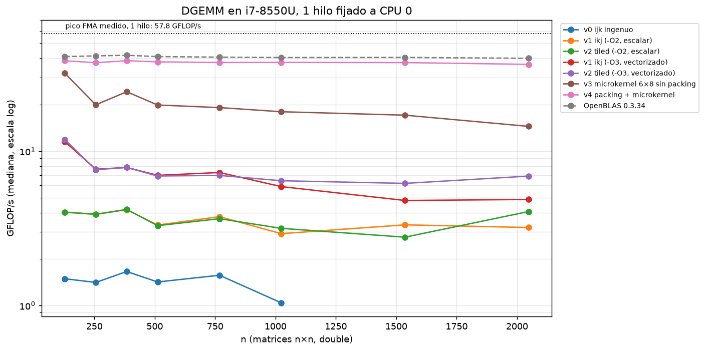
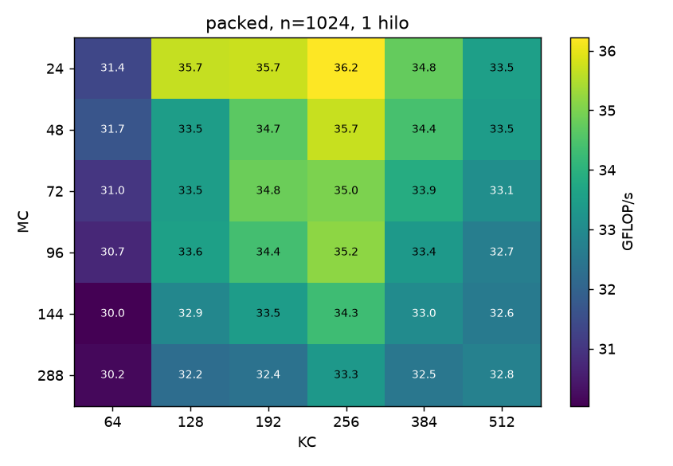
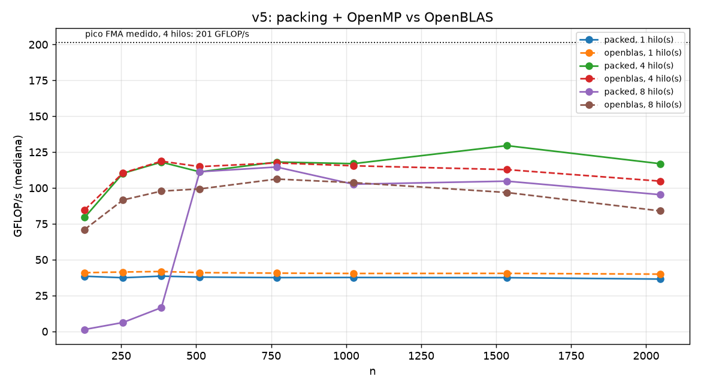

# gemm

Multiplicación de matrices densas en doble precisión (`C = A·B`, row-major) en C++20, desde el
bucle ingenuo hasta un microkernel AVX2+FMA con packing estilo BLIS y OpenMP. Se compara contra
OpenBLAS 0.3.34. Cada paso se mide y se explica qué lo limita.

| Versión | Función | Idea |
|---|---|---|
| v0 | `naive_ijk` | Producto punto por elemento; recorre B por columna |
| v1 | `loop_ikj` | Mismo cálculo reordenado: el bucle interno recorre filas contiguas |
| v2 | `tiled` | ikj por bloques para reutilizar un tile de B en caché |
| v3 | `simd_unpacked` | Microkernel 6×8 con intrinsics: 12 acumuladores ymm en registros |
| v4 | `packed` | Packing de paneles de A y B (los 5 bucles de BLIS) + el mismo microkernel |
| v5 | `packed(..., threads)` | v4 con el bucle `ic` repartido con OpenMP |

v1 y v2 también se compilan con `-O3` (`gemm::o3::`), porque con `-O2` GCC 16 no las vectoriza
(ver más abajo).

## Reproducir

```bash
cmake -S . -B build-asan -G Ninja -DGEMM_SANITIZE=ON -DCMAKE_BUILD_TYPE=Debug
cmake --build build-asan && ctest --test-dir build-asan        # 11 tests contra OpenBLAS
cmake -S . -B build -G Ninja && cmake --build build
tools/run_all.sh     # ~13 min; escribe results/*.csv
tools/plot.py        # results/*.png
```

## Verificación

Cada versión se compara contra `cblas_dgemm` con 10 formas: 1×1×1, tamaños que no son múltiplos
de 6 ni de 8, rectangulares (1×200, 200×1, 37×100×513) y cuadrados. La tolerancia de error
relativo es `4·K·ε`. No se espera igualdad bit a bit porque el orden de las sumas cambia entre
versiones. La salida se inicializa con basura para comprobar que se sobrescribe. Una variante usa
bloques diminutos (`MC=12, KC=7, NC=16`, 3 hilos) para ejercitar todos los bordes de los cinco
bucles. Además, multiplicar por la identidad debe dar B exacta. Todo pasa con ASan+UBSan.

## Entorno de medición

| | |
|---|---|
| CPU | Intel Core i7-8550U (Kaby Lake R), 4C/8T, AVX2+FMA (sin AVX-512), L1d 32 KiB, L2 256 KiB, L3 8 MiB |
| SO | Arch Linux, kernel 7.3.5-arch1-1 |
| Compilador | GCC 16.2.1, `-O2 -g -DNDEBUG -mavx2 -mfma` (salvo las variantes `-O3`) |
| Energía | Conectada a corriente, `intel_pstate` con EPP `performance`. Paquete entre 51 °C y 80 °C: hay throttling térmico |
| CPUs | 1 hilo en CPU 0; 4 hilos en CPUs 0-3 (núcleos físicos); 8 hilos en 0-7 (SMT) |
| Repeticiones | Mediana de 15 (n ≤ 512), 7 (n ≤ 1024) o 5 corridas, tras 1 de calentamiento |

OpenBLAS (compilado con OpenMP) y nuestra versión OpenMP corren en **procesos separados**. En la
primera medición compartían proceso: los hilos de un runtime se quedaban en espera activa y le
robaban CPU al otro, y OpenBLAS con 4 hilos caía de ~115 a ~75 GFLOP/s.

## Techos medidos (`bench/peak.cpp`)

| | 1 hilo | 4 hilos |
|---|---|---|
| Pico FMA doble precisión | **57.8 GFLOP/s** | **201 GFLOP/s** |
| Ancho de banda, triada tipo STREAM | **20.0 GB/s** | **21.3 GB/s** |

El pico sale de 12 cadenas independientes de `vfmadd231pd`. La latencia de FMA es de 4 ciclos y
hay 2 puertos, así que hacen falta al menos 8 cadenas. 57.8 GFLOP/s equivale a 16 FLOP/ciclo a
~3.6 GHz, no a los 4.0 GHz de turbo máximo: con AVX sostenido la frecuencia baja. Por eso los techos
se miden y no se calculan con la ficha técnica.

En la primera versión todas las cadenas empezaban con el mismo valor y GCC las fusionó en una sola.
El "pico" salía en 82.7 GFLOP/s, imposible para esta CPU, y el ensamblador lo confirmó. Ahora cada
cadena tiene un valor inicial distinto.

Punto de quiebre del roofline (pico / ancho de banda): **2.9 FLOP/B** con 1 hilo y **9.4 FLOP/B**
con 4 hilos. Por debajo de esa intensidad aritmética, el límite es la memoria.

## Resultados, 1 hilo



| Versión | n=128 | n=512 | n=1024 | n=2048 | % del pico (n=1024) |
|---|---|---|---|---|---|
| v0 ijk ingenuo | 1.49 | 1.42 | 1.04 | (no se corrió) | 1.8 % |
| v1 ikj `-O2` | 4.03 | 3.32 | 2.92 | 3.20 | 5.1 % |
| v2 tiled `-O2` | 4.02 | 3.29 | 3.16 | 4.06 | 5.5 % |
| v1 ikj `-O3` | 11.5 | 6.97 | 5.89 | 4.86 | 10 % |
| v2 tiled `-O3` | 11.9 | 6.90 | 6.43 | 6.89 | 11 % |
| v3 microkernel sin packing | 31.9 | 19.9 | 18.0 | 14.5 | 31 % |
| v4 packing + microkernel | 38.5 | 37.9 | **37.6** | **36.5** | **65 %** |
| OpenBLAS | 41.0 | 41.0 | 40.4 | 39.9 | 70 % |

Todas las cifras en GFLOP/s, mediana. CSV completo en `results/sizes_1t.csv`.

### Qué limita cada paso

**v0 → v1, orden de bucles.** En `ijk`, el bucle interno salta N doubles en B. Con n=1024 son 8 KiB
por paso, así que cada acceso cae en otra línea de caché y el prefetcher no ayuda. Además, la suma
en `s` es una reducción en punto flotante: sin `-ffast-math` el compilador no la puede reordenar
para vectorizarla. En `ikj`, el bucle interno recorre una fila de B y una de C, ambas contiguas.

**v1 y v2 con `-O2`: el límite es el código escalar, no la memoria.** `-fopt-info-vec` confirma que
GCC 16 con `-O2` no vectoriza estos bucles, y con `-O3` sí. La prueba de que el límite no era la
memoria: con `-O2`, tiled e ikj dan casi lo mismo. Si la memoria limitara, reutilizar tiles en
caché habría ayudado.

**v1 vs v2 con `-O3`: ahora sí manda la memoria.** Vectorizado, ikj cae de 11.5 a 4.86 GFLOP/s al
crecer n. Con n=2048, B ocupa 32 MiB (cuatro veces la L3) y `ikj` la recorre completa por cada fila
de A: 8 B leídos por cada 2 FLOP, es decir 0.25 FLOP/B. Con 20 GB/s, el techo es
20 × 0.25 = **5.0 GFLOP/s**, y se midieron **4.86**: ikj está pegado al techo de ancho de banda.
Tiled reutiliza el tile de B desde caché y se mantiene en 6.9. Aun así sigue lejos del pico, porque
sin bloqueo en registros cada FMA lee y escribe C en memoria.

**v3, microkernel en registros.** Los 12 acumuladores de un bloque 6×8 de C viven en registros
durante KC=256 pasos. Por cada k hay 2 loads de B, 6 broadcasts de A y 12 FMAs (96 FLOP). Esto
triplica a tiled. Pero empeora con n (31.9 → 14.5 GFLOP/s) porque A se lee con salto de K doubles
entre filas y B con salto de N. Con n potencia de 2, las 256 filas de un micropanel de B quedan a
16 KiB de distancia y caen en el mismo set de la L1 (8 vías). Es una explicación consistente con
los datos (n=384 y n=768 rinden más que 256, 512 y 1024), pero **no la medí con contadores**.

**v4, packing.** Antes de multiplicar, se copian los bloques de A (MC×KC) y B (KC×NC) a buffers
contiguos, en el orden exacto en que el microkernel los consume. El micropanel de B (KC×8 = 16 KiB)
vive en L1, el bloque de A en L2 y el panel de B en L3. Copiar cuesta O(n²) y la multiplicación
O(n³), así que el costo se amortiza. El rendimiento queda plano en ~37 GFLOP/s para todos los n:
ya no depende del tamaño, el límite es el cómputo del microkernel. El 30 % que falta para el pico
y el ~8 % que le saca OpenBLAS deben estar en el microkernel mismo (OpenBLAS usa ensamblador
escrito a mano con prefetch explícito). No lo analicé instrucción por instrucción.

### Barrido de bloques



v4 con n=1024: el mejor resultado es `MC=24, KC=256` con 36.2 GFLOP/s, y el peor `MC=144, KC=64` con
30.0. El valor típico de BLIS para Haswell (`MC=72`) da 35.0. Se tomó `MC=24` como valor por defecto.
En una prueba A/B intercalada (3 rondas, n=1024 y n=2048) también fue más rápido en las 6
comparaciones, por 4 % a 8 %. Con KC < 128 cae: hay poca reutilización por cada carga de C.

v2 `-O3` con n=2048 (`results/sweep_tiled.csv`): el mejor es `TK=256, TJ=1024` con 7.24 GFLOP/s y
el peor `TK=128, TJ=256` con 5.89. TI casi no influye.

## Resultados multihilo (v5)



| n | packed, 4 hilos | OpenBLAS, 4 hilos | packed, 8 hilos | OpenBLAS, 8 hilos |
|---|---|---|---|---|
| 512 | 111 | 115 | 111 | 99 |
| 1024 | 117 | 115 | 103 | 104 |
| 1536 | 130 | 113 | 105 | 97 |
| 2048 | 117 | 105 | 95 | 84 |

- **Con 4 hilos**, v5 empata o supera ligeramente a OpenBLAS. Escala 3.1× a 3.5× sobre 1 hilo, es
  decir 58-64 % del pico de 4 hilos. No llega a 4× en parte porque la frecuencia baja con 4 núcleos
  haciendo AVX: el pico medido de 4 hilos (201) es 3.5× el de 1 hilo, no 4×.
- **8 hilos (SMT) siempre es peor que 4:** los hilos hermanos comparten las mismas 2 unidades FMA,
  que un hilo bien alimentado ya satura.
- **v5 con 8 hilos y n ≤ 384 colapsa** (1.35 GFLOP/s con n=128) y OpenBLAS no. **No lo investigué.**
  Mi hipótesis: con matrices chicas, cada barrera de OpenMP espera al hilo más lento, y con las 8
  CPUs ocupadas cualquier proceso del sistema desplaza un hilo durante un tick del scheduler.
  OpenBLAS probablemente usa menos hilos con matrices chicas.

## Limitaciones conocidas

- Solo `C = A·B` con matrices cuadradas o rectangulares row-major. No hay `alpha`/`beta`, transpuestas
  ni leading dimensions.
- Microkernel fijo de 6×8 para AVX2, sin detección de CPU en tiempo de ejecución.
- Medido en una laptop de 15 W con throttling térmico. Las cifras absolutas varían ~5-10 % entre
  corridas largas; las comparaciones dentro de una misma corrida son más confiables.
